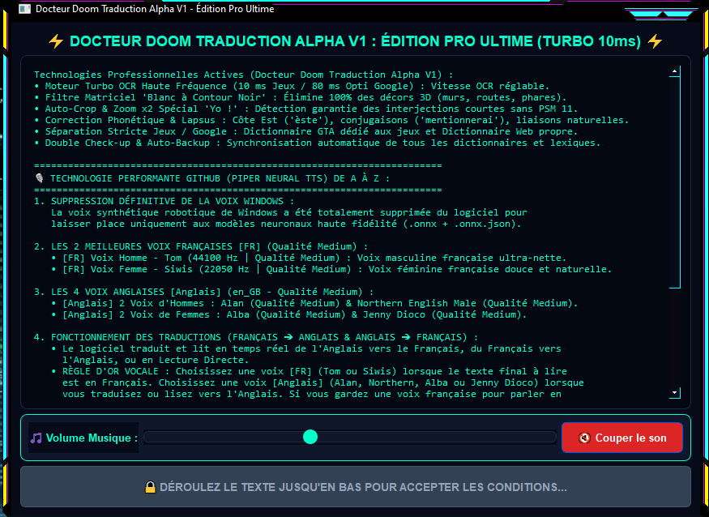
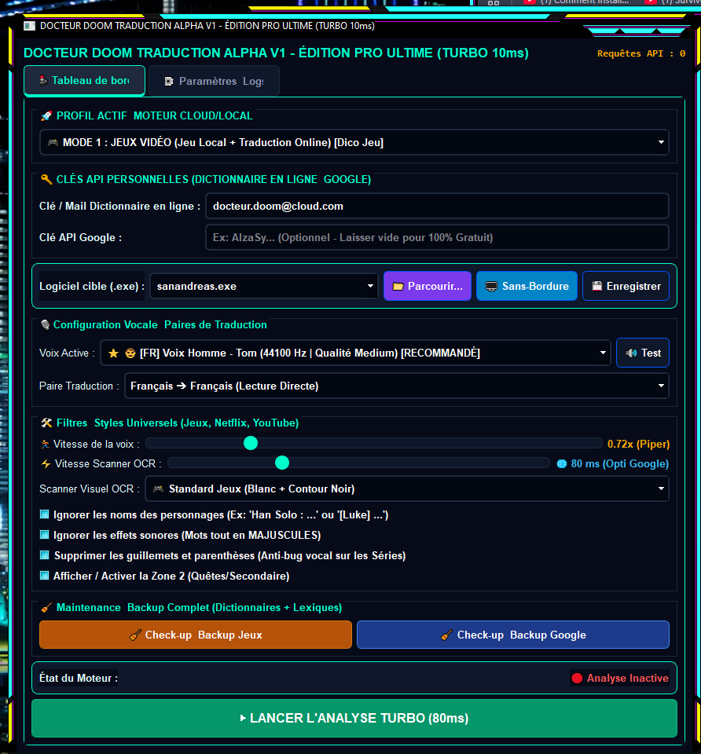
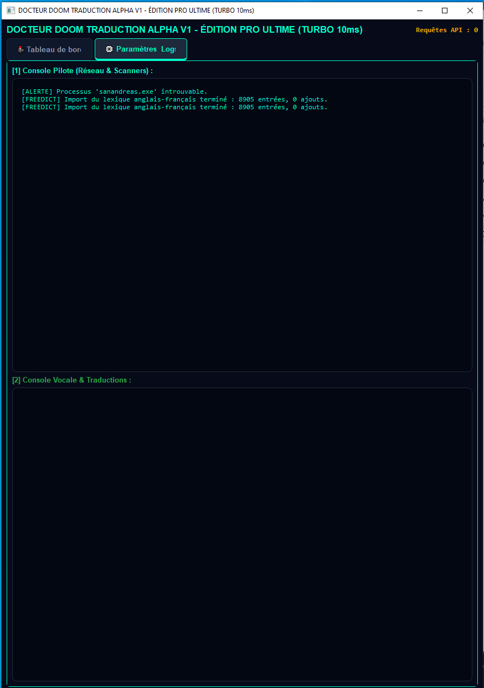
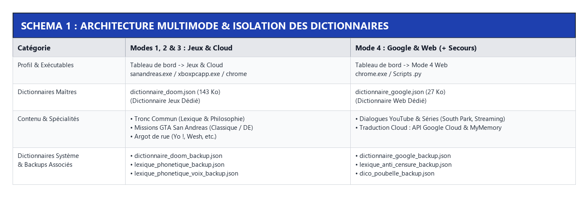
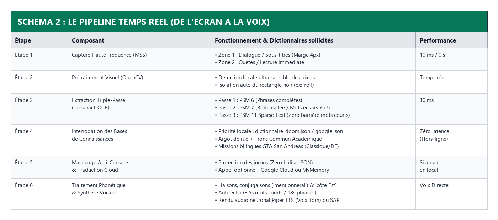
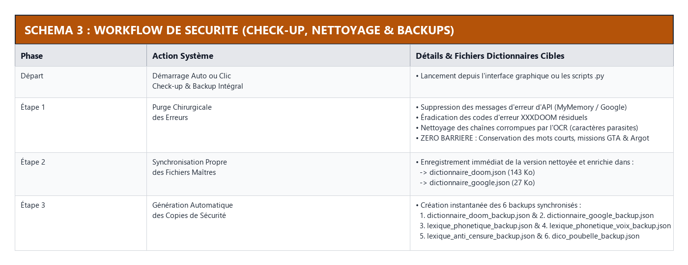
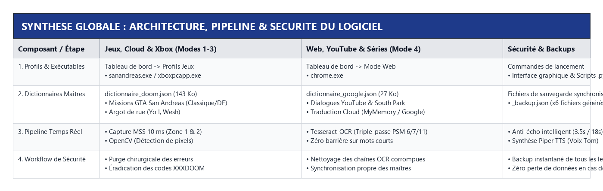

# Traducteur de jeux vidéo et multimédia en temps réel - Voix (Piper) et Lecture OCR

Traducteur de jeux vidéo et multimédia en temps réel (Turbo 10ms) ! Idéal pour GTA et les jeux non traduits (Français/Anglais). Permet également de lire et traduire les vidéos sur YouTube et en streaming directement à partir de Google (chrome.exe). Lecture OCR instantanée et synthèse vocale haute performance (**Piper**). Projet 100% gratuit et open-source à but éducatif. Rejoignez l'aventure et participez !

### Contribuer et comprendre le projet
Consultez les schémas et l'architecture technique détaillés plus bas pour comprendre le fonctionnement du pipeline en temps réel (OCR, Piper TTS, gestion des dictionnaires et sécurité). Toutes les contributions, suggestions ou améliorations sont les bienvenues !

- 🎥 Voir la démo GTA (1) : https://streamable.com/plshku
- 🎥 Voir la démo GTA (2) : https://streamable.com/bn7qg4
- 🎥 Voir la démo South Park : https://streamable.com/3kxvtl

## Captures d'écran

## Architecture et Schémas du Projet

Discord  1560715186808295565
